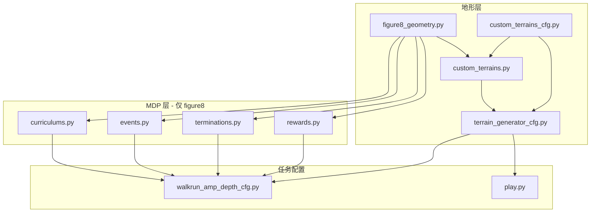

# S 弯 / 8 字桥 地形迁移指南

> **用途**：供新 Agent 将 `Noetix_e1_perception` 仓库中的 S 弯相关代码迁移到另一份工程（或独立子模块）。
>
> **源仓库路径**：`/home/user/perceptionobstacle/Noetix_e1_perception`
>
> **最后核对日期**：2026-07-11

---

## 1. 功能概览

本仓库实现了 **4 种 S 弯/桥类高度场地形**，按复杂度递增：

| 地形 key | 配置类 | 生成函数 | 几何简述 | 训练 MDP 支持 |
|----------|--------|----------|----------|---------------|
| `s_curve_bridge` | `HfSCurveBridgeTerrainCfg` | `s_curve_bridge_terrain` | 双半圆弧反向相切 + 中心方形高台 | 通用奖励/终止（无专用项） |
| `g1_s_curve_bridge` | `HfG1SCurveBridgeTerrainCfg` | `g1_s_curve_bridge_terrain` | G1 连续双 180° 弧窄桥（固定宽 0.5m） | **仅地形生成，未接入训练** |
| `figure8_bridge` | `HfFigure8BridgeTerrainCfg` | `figure8_bridge_terrain` | 平面闭合 8 字双圆环桥 + 可选中心挖空 | **完整 MDP**（奖励/终止/课程/出生） |
| `figure8_s_bridge` | `HfFigure8SCurveBridgeTerrainCfg` | `figure8_s_curve_bridge_terrain` | 半 8 字开口 S 通道（左上半环 + 右下半环） | **仅 play 演示，无 MDP** |

### 1.1 坐标系约定（重要）

- **Isaac 场地局部系**：原点在格子几何中心，`px_m = (i+0.5)*h_scale - size[0]/2`。
- **`s_curve_bridge`**：原点在场地**角点** `(0,0)`，X 总长 `4R = size[0]`。
- **`g1_s_curve_bridge`**：使用**用户坐标** + `pattern_origin_x/y_m` 平移到局部系。
- **`figure8_bridge` / `figure8_s_bridge`**：原点在 8 字几何中心；左右圆心 `x = ±r_c`，`r_c = inner_radius + bridge_width/2`。

### 1.2 难度 / 课程

- `s_curve_bridge`：`bridge_width_range` 线性插值；`holes_depth` 随 difficulty。
- `figure8_*`：`bridge_width_by_level` 离散 5 档（0.8→0.45m）；`terrain_levels` 行号映射 difficulty。
- `g1_s_curve_bridge`：几何固定，`difficulty` 被忽略。

---

## 2. 必须迁移的文件清单

### 2.1 核心地形（必迁）

```
source/NoetixE1/NoetixE1/terrains/custom_terrain/
├── figure8_geometry.py          # 8 字几何：环带判定、中心线采样、出生点、课程桥宽
├── custom_terrains_cfg.py       # 仅迁 4 个 Cfg 类（见 §2.4）
└── custom_terrains.py           # 仅迁 S 弯相关函数（见 §2.5）
```

**`custom_terrains.py` 中需复制的符号**（约 1630–1921 行）：

- `_g1_s_curve_radial_footprint`
- `_g1_s_curve_arm_height`
- `s_curve_bridge_terrain`
- `g1_s_curve_bridge_terrain`
- `_figure8_annulus_footprint`（figure8 共用）
- `_apply_figure8_center_cutout`（figure8 共用）
- `figure8_bridge_terrain`
- `figure8_s_curve_bridge_terrain`

**依赖的已有工具函数**（同文件，若目标仓库无 custom_terrains 需一并迁或复用）：

- `_smoothstep01`（约 1412 行）
- `@height_field_to_mesh` 装饰器（来自 `isaaclab.terrains.height_field.utils`）

### 2.2 地形注册（按需）

```
source/NoetixE1/NoetixE1/terrains/
├── terrain_generator_cfg.py     # sub_terrains 注册 + import
├── custom_terrain/__init__.py   # export Cfg 类
└── __init__.py                  # 顶层 re-export
```

当前注册状态：

- `DEPTH_TERRAINS_CFG`（旧）：含 `s_curve_bridge`（proportion=0.15）
- `DEPTH_TERRAINS_CFG6`（walkrun 主用）：**仅含 `figure8_bridge`**
- `g1_s_curve_bridge`、`figure8_s_bridge`：**未写入默认 generator**，仅在 `play.py` 单格演示

### 2.3 figure8 专用 MDP（迁移 figure8 训练时必迁）

```
source/NoetixE1/NoetixE1/tasks/walkrun/noetix_e1/mdp/
├── rewards.py       # figure8_bridge_* 奖励（约 745–1160 行）
├── terminations.py  # figure8_bridge_fall_off, figure8_bridge_riser_strike（约 103–275 行）
├── events.py        # figure8 出生采样（约 36–174, 277–283, 433+, 495+ 行）
└── curriculums.py   # terrain_levels_vel_with_termination 中 figure8 分支（约 593–685 行）
```

`mdp/__init__.py` 通过 `from .rewards import *` 等自动导出，**无需单独改 export 列表**。

### 2.4 `custom_terrains_cfg.py` 中 4 个配置类

| 类名 | 行号约 |
|------|--------|
| `HfSCurveBridgeTerrainCfg` | 604–626 |
| `HfFigure8BridgeTerrainCfg` | 629–667 |
| `HfFigure8SCurveBridgeTerrainCfg` | 670–710 |
| `HfG1SCurveBridgeTerrainCfg` | 713–762 |

均继承 `isaaclab.terrains.height_field.hf_terrains_cfg.HfTerrainBaseCfg`。

### 2.5 任务配置接入点

```
source/NoetixE1/NoetixE1/tasks/walkrun/noetix_e1/walkrun_amp_depth_cfg.py
scripts/rsl_rl/play.py
```

---

## 3. 模块依赖图



---

## 4. 分场景迁移步骤

### 场景 A：只迁 `s_curve_bridge`（最简单）

1. 复制 `custom_terrains_cfg.HfSCurveBridgeTerrainCfg` + `s_curve_bridge_terrain`。
2. 在目标 `terrain_generator_cfg.sub_terrains` 注册 `"s_curve_bridge"`。
3. 在 `custom_terrain/__init__.py` 与 `terrains/__init__.py` 增加 export。
4. （可选）在任务 cfg 中：
   - `CommandsCfg.base_velocity.terrain_specific_ranges["s_curve_bridge"]`
   - `RewardsCfg` 中 `feet_unhold` / `volume_points_penetration_*` / `feet_flat_ori` 的 `terrain_types` 元组
   - `TerminationsCfg.fall_down_in_some_terrain.terrain_types` 列表

**无需** `figure8_geometry.py`。

### 场景 B：迁 `figure8_bridge` 完整训练链路（推荐论文/演示主场景）

1. 完成场景 A 的基础设施（height_field 管线）。
2. **整文件复制** `figure8_geometry.py`。
3. 复制 `HfFigure8BridgeTerrainCfg` + `figure8_bridge_terrain` + `_figure8_annulus_footprint` + `_apply_figure8_center_cutout`。
4. 注册到 `DEPTH_TERRAINS_CFG6` 或等价 generator（参考默认参数）：

```python
"figure8_bridge": HfFigure8BridgeTerrainCfg(
    proportion=0.2,
    size=(12.0, 12.0),           # 必须 >= 12m
    inner_radius_m=2.5,
    bridge_height=0.1,
    bridge_width_by_level=(0.9, 0.8, 0.7, 0.6, 0.5),
    holes_depth=(0, 0),
    center_cutout_width_m=0.8,
    center_cutout_length_m=0.8,
),
```

5. 迁移 MDP 函数（见 §5）。
6. 在 `walkrun_amp_depth_cfg.py` 接入奖励/终止/命令（见 §6）。
7. （强烈建议）在 `EventCfg.reset_robot_states` 增加 `terrain_specific_figure8_spawn`（当前源仓库**尚未默认启用**，但 `events.py` 已支持）。

### 场景 C：迁 `figure8_s_bridge`（半 8 字 S 开口桥）

1. 完成场景 B 的 `figure8_geometry` + annulus 工具函数。
2. 复制 `HfFigure8SCurveBridgeTerrainCfg` + `figure8_s_curve_bridge_terrain`。
3. `play.py` 已有单格演示（`--showcase_terrain figure8_s_bridge`）。
4. **若需训练**：需自行扩展 MDP——当前无专用奖励/终止；可复用 figure8 几何但需改「有效支撑面」掩码（半环而非全环）。

### 场景 D：迁 `g1_s_curve_bridge`

1. 复制 `HfG1SCurveBridgeTerrainCfg` + `g1_s_curve_bridge_terrain` + `_g1_s_curve_*` 辅助函数。
2. 自行注册到 `sub_terrains`（源仓库仅 import，未默认注册）。
3. 注意 `pattern_origin` 与 `spawn_flat_radius_m` 用于起点平地出生。

---

## 5. figure8 MDP API 速查

### 5.1 `figure8_geometry.py` 关键函数

| 函数 | 用途 |
|------|------|
| `centerline_radius_m` / `outer_radius_m` | 中心线/外缘半径 |
| `bridge_width_for_terrain_levels` | 按课程行取桥宽（与地形生成一致） |
| `centerline_points_torch` | MDP 路径折线缓存 |
| `foot_xy_on_bridge_annulus_torch` | 脚 XY 是否在双圆环带内 |
| `foot_xy_on_figure8_support_torch` | 环带 ∪ 中心挖空矩形 |
| `sample_path_spawn_xy_yaw` | 在指定弧段采样出生点 |
| `sample_center_cutout_spawn_xy_yaw` | 中心坑底出生 |
| `half_loop_arc_length_m` | 课程升档阈值 `π * r_c` |

### 5.2 `rewards.py` — figure8 专用项

| 函数 | 当前 walkrun 是否启用 | 说明 |
|------|----------------------|------|
| `figure8_bridge_commanded_idle_penalty` | ✅ weight=-1.0 | 有指令但机身不动 |
| `figure8_bridge_lateral_offset_penalty` | ✅ weight=-1.0 | 脚偏离中心线横向距离 |
| `figure8_feet_impact`（复用 `feet_impact`） | ✅ weight=-10.0 | 8 字上脚冲击 |
| `figure8_bridge_path_forward_reward` | ❌ 已注释 | 沿切向速度奖励 |
| `figure8_bridge_path_progress_reward` | ❌ 已注释 | 累计弧长（课程依赖此项写 `figure8_episode_arc_m`） |
| `figure8_bridge_on_bridge_reward` | 未接入 cfg | 双脚在桥上奖励 |
| `figure8_bridge_unsafe_foot_penalty` | 未接入 cfg | 踩空惩罚 |

**全局奖励对 figure8 的特殊处理**：

- `track_ang_vel_z_exp`：`skip_terrain_types=("figure8_bridge",)` — 不跟踪绕 z 角速度
- `delta_yaw_reward`：`terrain_types=("figure8_bridge",), scale_on_terrain=0.0` — 关闭偏航增量惩罚
- `feet_impact`（全局）：`skip_terrain_types=("figure8_bridge",)` — 由专用项接管

### 5.3 `terminations.py`

| 函数 | 说明 |
|------|------|
| `figure8_bridge_fall_off` | 落地后脚离开有效区或 root 下沉 > 0.06m |
| `figure8_bridge_riser_strike` | 中心挖空危险区内水平撞击（**cfg 中未默认启用**） |

环境缓存字段（`env.unwrapped`）：

- `figure8_landed`, `figure8_root_z_at_landing`
- `figure8_prev_path_t`, `figure8_prev_path_valid`, `figure8_episode_arc_m`（path_progress 奖励用）
- `_figure8_polyline_cache`（中心线缓存）

### 5.4 `events.py` — figure8 出生

`reset_root_state_amp(..., terrain_specific_figure8_spawn: dict | None)` 支持两种模式：

```python
# 模式 1：路径出生（桥面上）
terrain_specific_figure8_spawn = {
    "spawn_mode": "path",  # 默认
    "inner_radius_m": 2.5,
    "bridge_width_m": 0.5,
    "bridge_height": 0.1,
    "position_noise": 0.15,
    "path_loop_ranges": [
        {"loop": "right", "theta": (0.55 * math.pi, 0.95 * math.pi)},
    ],
}

# 模式 2：中心挖空出生（坑底）
terrain_specific_figure8_spawn = {
    "spawn_mode": "center_cutout",
    "center_cutout_width_m": 0.8,
    "center_cutout_length_m": 0.8,
    "base_yaw_angles": (1.57, 3.14),
    "yaw_jitter_deg": 75.0,
    "position_noise": 0.0,
}
```

也可把 figure8 配置嵌在 `terrain_specific_pos_range["figure8_bridge"]` 中（会被自动识别）。

### 5.5 `curriculums.py`

`terrain_levels_vel_with_termination` 对 `figure8_bridge`：

- **move_up**：`figure8_episode_arc_m >= π * r_c` 且未 `figure8_bridge_fall_off`
- **move_down**：仅 `figure8_bridge_fall_off`

> ⚠️ **注意**：当前 `figure8_path_progress_reward` 在 cfg 中**已注释**，`figure8_episode_arc_m` 可能不会更新，导致 **figure8 课程升档失效**。迁移后若启用 figure8 课程，需恢复 path_progress 奖励或改课程逻辑。

---

## 6. `walkrun_amp_depth_cfg.py` 接入片段

### 6.1 场景地形

```python
from NoetixE1.terrains.terrain_generator_cfg import DEPTH_TERRAINS_CFG6

scene.terrain.terrain_generator = DEPTH_TERRAINS_CFG6  # 含 figure8_bridge
```

### 6.2 速度指令（`CommandsCfg`）

```python
"s_curve_bridge": Ranges(lin_vel_x=(0.0, 1.5), lin_vel_y=(0.0, 0.0), ang_vel_z=(-1.0, 1.0), ...),
"figure8_bridge": Ranges(lin_vel_x=(0.0, 2.5), lin_vel_y=(0.0, 0.5), ang_vel_z=(0.0, 0.0), ...),
```

figure8 故意不采样 `ang_vel_z`，靠路径几何引导转向。

### 6.3 奖励 / 终止

见源文件 `RewardsCfg` 803–868 行、`TerminationsCfg` 1155–1164 行。按 §5.2/5.3 表复制 `RewTerm` / `DoneTerm` 块。

### 6.4 课程

```python
terrain_levels = CurrTerm(func=mdp.terrain_levels_vel_with_termination)
```

---

## 7. `play.py` 单格演示

```bash
# 闭合 8 字桥
python scripts/rsl_rl/play.py --task <TASK> --showcase_terrain figure8_bridge --showcase_difficulty 1.0

# 半 8 字 S 开口桥
python scripts/rsl_rl/play.py --task <TASK> --showcase_terrain figure8_s_bridge --showcase_difficulty 1.0
```

`play.py` 会强制 `terrain_generator.size = (12, 12)` 且 `sub_terrains` 仅保留单一地形 `proportion=1.0`。

---

## 8. Agent 执行 Checklist

按顺序执行，每步完成后编译/导入检查：

- [ ] **T1** 确认目标工程有 Isaac Lab `height_field_to_mesh` 管线
- [ ] **T2** 复制 `figure8_geometry.py`（若迁 figure8 系列）
- [ ] **T3** 复制 `custom_terrains_cfg.py` 中对应 Cfg 类
- [ ] **T4** 复制 `custom_terrains.py` 中对应生成函数及 `_smoothstep01` 等依赖
- [ ] **T5** 更新 `custom_terrain/__init__.py` 与 `terrains/__init__.py` export
- [ ] **T6** 在 `terrain_generator_cfg.py` 注册 `sub_terrains` 条目
- [ ] **T7**（figure8 训练）复制 `rewards.py` / `terminations.py` / `events.py` / `curriculums.py` 中 figure8 段落
- [ ] **T8** 在任务 cfg 接入 Commands / Rewards / Terminations / Curriculum
- [ ] **T9**（可选）配置 `terrain_specific_figure8_spawn`
- [ ] **T10** 恢复 `figure8_path_progress_reward`（若需 figure8 课程升档）
- [ ] **T11** `play.py` 增加 `--showcase_terrain` 分支（若需可视化）
- [ ] **T12** 运行单格 play + 短训练 smoke test

### 8.1 导入烟雾测试

```python
from NoetixE1.terrains.custom_terrain.figure8_geometry import foot_xy_on_bridge_annulus_torch
from NoetixE1.terrains.custom_terrain.custom_terrains_cfg import (
    HfSCurveBridgeTerrainCfg,
    HfFigure8BridgeTerrainCfg,
    HfFigure8SCurveBridgeTerrainCfg,
    HfG1SCurveBridgeTerrainCfg,
)
from NoetixE1.terrains.custom_terrain import custom_terrains

hf = custom_terrains.s_curve_bridge_terrain(0.5, HfSCurveBridgeTerrainCfg(size=(8.0, 8.0)))
assert hf.shape[0] > 0 and hf.shape[1] > 0
print("S-curve terrain OK", hf.shape)
```

### 8.2 常见报错

| 报错 | 原因 | 处理 |
|------|------|------|
| `figure8_bridge sub_terrain not found` | generator 未注册 key | 检查 `sub_terrains` 名称一致 |
| `bridge_width_by_level must not be empty` | figure8 cfg 缺桥宽档位 | 补 `bridge_width_by_level` 元组 |
| 机器人出生在坑底/悬空 | 未配 figure8 spawn 或 origin 偏移 | 启用 `terrain_specific_figure8_spawn` 或调 `root_pos_range` |
| figure8 永不升课程难度 | path_progress 奖励被注释 | 恢复奖励或改 `curriculums.py` 升档条件 |
| 场地尺寸穿模 | figure8 用 8×8 | 强制 `size=(12, 12)` |

---

## 9. 已知缺口（迁移时需决策）

1. **`figure8_s_bridge` 无 MDP**：仅有地形 + play 演示；训练需新写半环支撑判定与奖励。
2. **`g1_s_curve_bridge` 未接入训练 cfg**：仅地形实现完整。
3. **`terrain_specific_figure8_spawn` 未写入默认 `EventCfg`**：`events.py` 支持但 `walkrun_amp_depth_cfg.py` 的 `reset_robot_states` 未传参。
4. **`figure8_bridge_riser_strike` 终止未启用**：防止中心棱边撞击的可选终止。
5. **`figure8_path_progress_reward` 已注释** 但课程文档仍引用 `figure8_episode_arc_m`——逻辑不一致，迁移时应二选一对齐。
6. **`s_curve_bridge` 与 `figure8_bridge` 坐标原点不同**：不可混用同一套 foot XY 判定函数。

---

## 10. 推荐最小迁移包（按目标裁剪）

### 包 M1：仅 S 弯窄桥（轻量）

```
custom_terrains_cfg.py   → HfSCurveBridgeTerrainCfg
custom_terrains.py       → s_curve_bridge_terrain
terrain_generator_cfg.py → "s_curve_bridge" 注册
walkrun_amp_depth_cfg.py → terrain_types 元组补丁
```

### 包 M2：8 字桥完整训练（当前主线路）

```
figure8_geometry.py                          # 整文件
custom_terrains_cfg.py                       # HfFigure8BridgeTerrainCfg
custom_terrains.py                           # figure8_bridge_terrain + 辅助函数
terrain_generator_cfg.py                     # DEPTH_TERRAINS_CFG6.figure8_bridge
mdp/rewards.py                               # figure8_* 段
mdp/terminations.py                          # figure8_bridge_fall_off
mdp/events.py                                # figure8 spawn 段
mdp/curriculums.py                           # figure8 课程分支
walkrun_amp_depth_cfg.py                     # Commands/Rewards/Terminations/Curriculum
scripts/rsl_rl/play.py                       # figure8_bridge showcase（可选）
```

### 包 M3：全系列（含演示）

M2 + `HfFigure8SCurveBridgeTerrainCfg` + `figure8_s_curve_bridge_terrain` + `HfG1SCurveBridgeTerrainCfg` + `g1_s_curve_bridge_terrain` + `play.py` 的 `figure8_s_bridge` 分支。

---

## 11. 给新 Agent 的执行 Prompt 模板

可直接复制以下指令给迁移 Agent：

```
请阅读 docs/s_curve_migration_guide.md，将 Noetix_e1_perception 中的 S 弯内容迁移到 <目标路径>。

迁移目标：<M1|M2|M3 选一>
目标工程 Isaac Lab 版本：<版本>
任务配置文件：<目标 cfg 路径>

要求：
1. 严格按文档 §8 Checklist 顺序执行
2. 保持地形 key 名称不变：s_curve_bridge / figure8_bridge / figure8_s_bridge / g1_s_curve_bridge
3. 若选 M2：一并修复 figure8 课程与 path_progress 奖励的不一致（§9.5）
4. 完成后运行 §8.1 烟雾测试，并给出 play.py 演示命令
5. 输出变更文件列表与仍需人工确认的配置项
```

---

## 12. 关键默认参数速查

### `s_curve_bridge`

| 参数 | 默认 |
|------|------|
| size | 继承 generator（通常 8×8） |
| bridge_height | 0.1 m |
| bridge_width_range | (0.8, 0.4) m |
| holes_depth | (-0.3, -0.5) m |
| platform_width | 2.0 m |

### `figure8_bridge`

| 参数 | 默认 |
|------|------|
| size | (12, 12) m |
| inner_radius_m | 2.5 m |
| bridge_height | 0.1 m |
| bridge_width_by_level | (0.8, 0.7, 0.6, 0.5, 0.45) m |
| center_cutout | 0.8 × 0.8 m（CFG6 启用） |
| radial_edge_fade_m | 0.03 m |

### `g1_s_curve_bridge`

| 参数 | 默认 |
|------|------|
| bridge_width_m | 0.5 m |
| arc_radius_m | 2.5 m |
| bridge_length_m | 10 m |
| bridge_height_m | 0.10 m |
| junction_extra_half_width_m | 0.12 m |

---

*文档维护：若增删地形 key 或 MDP 项，请同步更新 §2 文件清单与 §5 API 表。*
